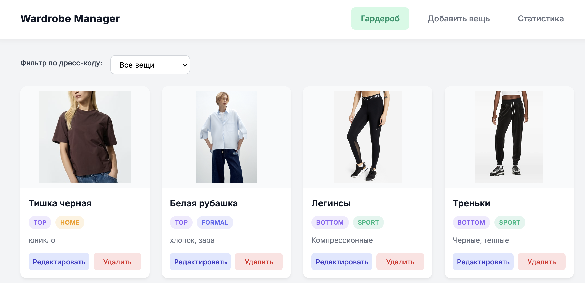
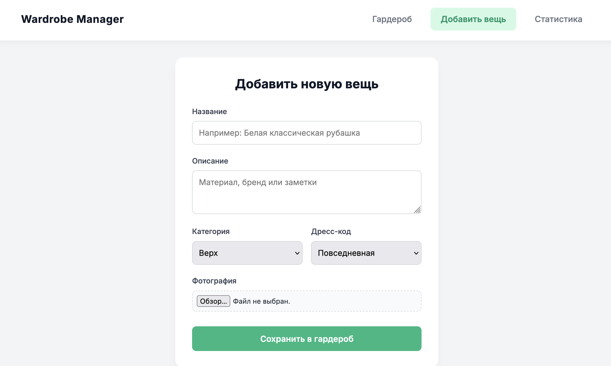
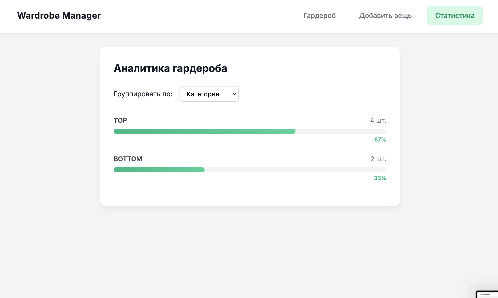

# Курсовой проект: Менеджер гардероба (Wardrobe Manager)

## 1. О проекте
Этот проект представляет собой веб-сервис для учета личных вещей в гардеробе. 
Он помогает вести цифровой список одежды, прикреплять к вещам фотографии и 
быстро понимать, что именно у вас есть.

**Для кого:** для тех, кто хочет навести порядок в шкафу, провести ревизию вещей и избежать случайных покупок.  
**Какую задачу решает:** заменяет бумажные списки или заметки в телефоне удобным каталогом с поиском, фильтрами и простой аналитикой.

## 2. Основной функционал
- Полноценные CRUD-операции: можно добавить вещь, посмотреть список, отредактировать данные или удалить запись.

- Загрузка и хранение фотографий вещей (файлы сохраняются локально на сервере).

- Классификация: у каждой вещи есть категория (верх, низ, обувь, аксессуары, верхняя одежда) и стиль (домашний, деловой, повседневный, спортивный).
- Фильтрация общего списка по выбранному стилю одежды.

- Статистика гардероба: подсчет количества вещей по категориям или стилям.

## 3. Интерфейс пользователя
Фронтенд сделан на Vue.js и состоит из нескольких основных частей:
- **Главная страница:** адаптивная сетка карточек. На карточке видно фото, название и теги. Сверху есть выпадающий список для фильтрации. У каждой вещи есть кнопки "Редактировать" и "Удалить".
- **Страница добавления:** форма, где можно заполнить название, описание, выбрать параметры из списков и загрузить картинку.
- **Страница статистики:** простые и понятные прогресс-бары, показывающие распределение вещей. Можно переключать вид: группировка по категориям или по стилю.
- **Модальное окно:** при нажатии на "Редактировать" открывается окно поверх страницы, что позволяет менять данные без перезагрузки.

## 4. REST API
Сервис предоставляет следующие эндпоинты:
- `GET /api/clothes` – получить список всех вещей.
- `GET /api/clothes/{id}` – получить данные конкретной вещи.
- `POST /api/clothes` (multipart/form-data) – добавить новую вещь с фото.
- `PUT /api/clothes/{id}` – обновить данные вещи (название, описание, категория, стиль).
- `DELETE /api/clothes/{id}` – удалить вещь (запись из БД и файл с диска).
- `GET /api/clothes/stats?type=category|dressCode` – получить статистику.
- `GET /api/images/{filename}` – получить загруженное изображение.

## 5. Масштабирование
На данный момент сервис рассчитан на локальное использование (встроенная БД H2 в памяти, хранение файлов на диске). В будущем его можно легко доработать:
1. Заменить H2 на PostgreSQL для надежного хранения данных.
2. Перенести хранение картинок с локального диска в облачное хранилище.
3. Добавить систему регистрации и авторизации (JWT), чтобы у каждого пользователя был свой личный гардероб.
4. Упаковать приложение в Docker-контейнер для удобного развертывания.

## 6. Технологии и архитектура
**Backend:** Java 17, Spring Boot 3, Spring Data JPA, H2 Database, Lombok.  
**Frontend:** Vue 3 (Composition API), Vite, Axios, Vue Router, CSS Grid/Flexbox.

**Использованные паттерны проектирования:**
- **Strategy:** применен для расчета статистики. Класс `AnalysisContext` выбирает нужную стратегию в зависимости от параметра запроса. Это позволяет легко добавить новый вид аналитики в будущем, не меняя основной код сервиса (принцип OCP).
- **Global Exception Handling:** все ошибки (например, `ClothingNotFoundException` или `InvalidFileException` при загрузке не-картинки) обрабатываются централизованно через `@ControllerAdvice`. Это позволяет возвращать клиенту понятные JSON-ответы с кодами 400 или 404.

## 7. Тестирование
В проекте реализовано автоматическое тестирование:
- **Модульные тесты** (`ClothingServiceTest`): проверяют валидацию типов файлов и логику сервисного слоя с помощью Mockito.
- **Интеграционные тесты** (`ClothingControllerIntegrationTest`): проверяют полный цикл работы контроллеров (создание, получение, удаление) через `MockMvc`.
- Запуск всех тестов осуществляется командой: `mvn test`.

## 8. Как запустить
1. **Backend:** Откройте проект в IntelliJ IDEA и запустите главный класс `WardrobeManagerApplication` (сервер поднимется на порту 8080).
2. **Frontend:** Откройте терминал, перейдите в папку `frontend`, выполните `npm install`, а затем `npm run dev` (сервер запустится на порту 5173).
3. Откройте в браузере адрес: `http://localhost:5173`.

## 9. Итоги работы
В ходе выполнения курсового проекта был разработан полноценный веб-сервис. Реализовано 7 REST-эндпоинтов, написан адаптивный фронтенд на Vue.js с модальными окнами, а также покрыт тестами основной функционал.

Главная цель достигнута: создан рабочий инструмент, который не просто хранит данные об одежде, но и анализирует их (благодаря паттерну Strategy), что делает его удобным и потенциально полезным для реального использования.